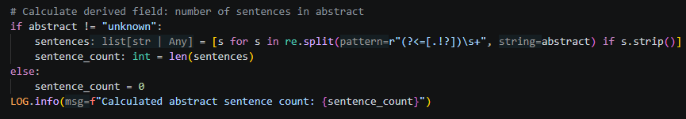

# Workflow D: Apply Skills

## Technical Modification

Run Using the command:
uv run python -m nlp.pipeline_web_html

For section D, we a apply a technical modification to the example project. For this project I added a sentence count for the abstract. It was a suggested modification but also made the most sense. This is because there is limited data on arxiv.org, but also there was not much else that provided meaningful analysis without acquiring more data. For instance, you could count the genders of the authors to see if there are more male or female contributors to this topic but the genders are not listed on that webpage so we'd have to go find additional information.

I forgot to make a new file before adding in the sentence count, so I just left it in the example file: stage03_transform.py

The code counts the number of times there is an ending punctuation mark with a space after it, so that it would only count the end of sentences instead of any punctuation mark or decimal numbers in the abstract.

After that I added sentence_count to the records so that it would show up in the dataframe. I also created a log output with the other derived fields so that all of that information was altogether.

## Custom Application

Run using the command:

mistake of not changeing what was parsed between abstract and title, so it was originally giving me the same number for tital word count and abstract word count.

| Arxiv ID   | Author Count  | Title Word Count  | Abstract Word Count | Abstract Sentence Count |
|--------------|----------|----------|----------|----------|
| 2602.20021 | 38 | 3 | 177 | 9 |
| 2611.29009 | 1 | 18 | 244 | 8 |
| 2611.30385 | 5 | 12 | 282 | 12 |
| 2611.30779 | 4 | 10 | 288 | 8 |
| 2611.30849 | 3 | 6 | 157 | 5 |
